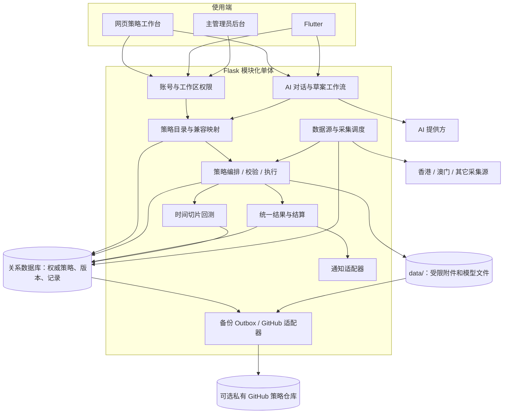
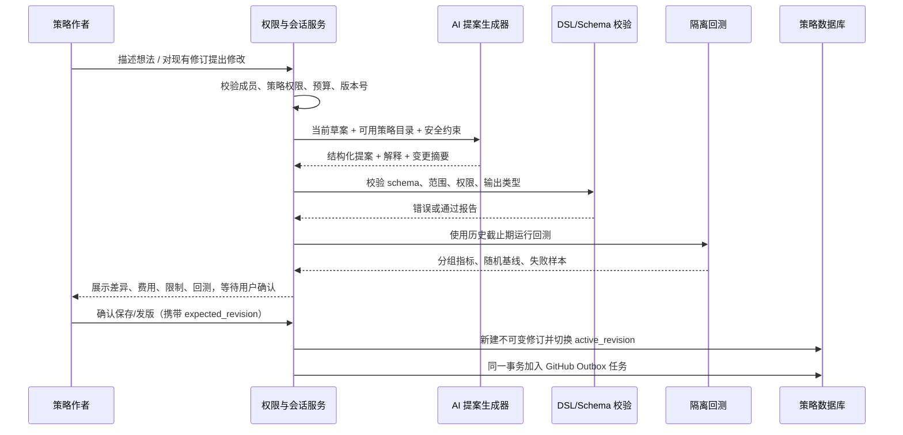

# 多账号自定义策略平台：完整架构方案

**状态：核心实施和隔离验收已补齐；本轮修复了迁移越权、草案重复发布、回测未来数据、移动/网页 CSRF、备份重试与恢复外键问题，并补齐多工作区、订阅撤销、本地策略包恢复和 CI 门禁。生产部署、真实 GitHub 凭据及跨开奖周期核对属于上线步骤。**

**基线：** 方案基线 `master` 头为 `8104d193`（2026-11-25）；其中已包含 `feature/zodiac-rebound` 的全部提交及当时最新 `upstream/master`（`56c1241`）。方案基线时核对上游为 `56c1241`；本轮没有重新获取上游实时状态。

实现代码位于 `strategy_platform/`，旧策略 API 和 `PredictionRecord` 保持兼容；V2 的自定义结果写入 `strategy_runs`。成员账号加入默认工作区由 owner 显式授权，工作区角色与站点 `is_admin` 分离。GitHub 同步需在部署环境设置 `STRATEGY_GITHUB_TOKEN`，策略导入先生成草稿供 owner 确认。

本轮验收状态及可复现命令见 [验证与上线操作](strategy-platform-v2-validation.md)。实际工作分支为 `feature/strategy-platform-v2`，保留此前未提交实现；未提交、推送或替换运行中的服务。

| 阶段 | 当前实现与验收 |
| --- | --- |
| 0：基线/迁移 | 编号迁移账本；临时 SQLite 与本机 MariaDB 旧 schema 升级、故障恢复、全量导入/导出外键关系已验证 |
| 1：目录/执行/结果 | 目录能力与参数边界统一；严格 cutoff；生肖复制保持原算法；统一结算/回测口径与失败运行重试 |
| 2：工作区/版本/权限 | 显式加入成员、多工作区、owner 转移并发保护、私有提案隔离、归档/共享撤回/订阅撤销、审计与版本冲突 |
| 3：备份恢复 | 本地包摘要和兼容性校验→预览→私有草稿；GitHub 限流/断网/令牌失效重试、远端内容核验、不可变 Outbox、归档 tombstone；换容器持久化已验证 |
| 4：AI 助手 | 受限规则提案、额度/输入边界、过期/终态保护、真实逐期回测、显式确认发布；网页使用独立多轮聊天页、会话恢复和服务错误重试，Flutter 保留兼容 API |
| 5：已有算法/来源 | 既有 ML/AI 保持兼容适配，澳门来源追加快照并保存时间/版本/摘要；发布时间未知不计公平样本。新增算法/站点继续通过常规代码审核发行 |
| 上线 | 尚需部署目标库副本核验、实际私有 GitHub 凭据/首次提交验证、签名发布及至少一个开奖周期旧/新订阅对照；本轮不宣称这些已上线 |

本轮工作区操作补齐：后台侧栏“策略工作区”统一管理分组名称并提供工作区备份入口；复制可命名，策略可编辑名称与受限参数；生肖遗漏回补副本支持统计窗口与单双连开阈值（默认保持原算法）；AI 修改进入独立聊天页，恢复本人历史，展示完整回复、当前规则和待确认草案。编号迁移 2 在启动时修正旧默认工作区名称，不覆盖自定义名称。GitHub 备份仍由工作区 owner 管理，使用站点统一部署凭据。

本轮聊天页验证使用模拟 AI 服务与临时数据库。实际配置的供应商曾返回仅支持 Coding 客户端/CLI 的限制；需要管理员配置允许普通服务端调用的接口，不能据界面和模拟测试声称真实供应商连接已恢复。

## 1. 目标与方案摘要

让小圈子成员能直接和 AI 描述策略想法，并把经过校验、回测、确认的策略保存为自己或工作区的版本；成员可以在网页和移动端运行或订阅自动预测；工作区主管理员可以审阅所有策略、管理授权、导出备份和恢复版本。所有帐号、权限、策略版本和执行记录在 Docker 重建后都仍然存在。

采用**模块化 Flask 单体 + 关系型数据库 + 可选私有 GitHub 版本备份**。数据库是线上运行的唯一事实来源；GitHub 是可追溯、可离线恢复的策略副本。当前 SQLite 和 MySQL/MariaDB 部署仍可沿用；不因本次扩展强行引入 Redis、微服务或新数据库。第一阶段只允许保存声明式规则和已登记的算法模板，不执行用户或 AI 生成的 Python 代码。

把「策略」和「数据源」作为不同的概念：热门、ML、AI、生肖规则等会产出预测的实现是策略；澳门“五码五肖”当前由 `MacauCollectedData` 存储，页面/API负责采集展示，是外部发布数据而不是本站策略输出。现有行按地区和期号唯一，采集更新会覆盖号码/生肖字段；扩展时需保留兼容读取并把后续来源版本作为不可变 snapshot 追加，先记录来源、期号、发布时间（未知时明确标未知）、采集时间，再由有权限的策略选择是否使用它。

## 2. 从当前代码看到的架构约束

### 2.1 预测结果被固定成一个号码组合

`PredictionRecord` 要求每条记录有 `normal_numbers` 和 `special_number`，业务准确率也主要按单个特码计算。生肖遗漏回补虽然有独立算法文件，却把六肖、四肖以及完整覆盖号码放在 `prediction_metadata`，通过多处策略分支补足站内通知、回测和页面展示。两个号码字段目前是非空，且旧 `strategy` 字段长度只有 20；只给旧表增加 JSON 字段无法稳妥承载非号码结果或 UUID 策略标识。V2 应以独立的通用运行/结果实体承载新输出，旧表只为现有 API 和历史记录提供兼容。

### 2.2 策略声明和能力散落

策略标识和策略名分别维护在 `app.py`、`user.py`、`admin.py`、`api_mobile.py`、网页模板、JavaScript、Flutter 客户端和回测脚本。自动预测白名单、回测集合、自动优化集合、移动端策略列表也各自维护。新增策略因此容易漏掉自动运行、结果筛选、回测或通知中的某个登记点。

### 2.3 推理实现形态不统一

本地规则策略从 `get_local_recommendations` 分派；ML 有训练缓存、历史补齐和集成选择；AI 使用另一条预测管线与 SSE 流式路由；外部“五码五肖”在独立 API 中抓取并展示，不属于普通预测记录。这些功能并不应该塞进同一个“计算号码”函数，但都应提供一致的能力声明、权限、结果封装和运行追踪。

### 2.4 账号个性化不是用户自定义策略

当前 `enable_personalized_predictions` 是系统级开关。它让已有号码策略依据 `user_id + region + period + strategy` 在排名候选池中固定轮换选号，并将预测记录分开保存；不创建每人的独立参数、规则或模型。V2 策略本身按 subscription/revision/subject 隔离，不依赖这个全站开关；旧内置策略在兼容期仍遵循现有共享/个性化行为，避免改坏现有用户。生肖遗漏回补目前按固定规则计算；AI 单独调用 API；管理权限目前主要是布尔型 `is_admin`。不应把这几个概念混成“管理员好友”。

### 2.5 Docker 存储与备份已有基础，但需扩展

Compose 已把宿主机 `./data` 挂载到容器 `/app/data`。策略、修订和运行数据应进入数据库，容器重建即可保留；模型大文件再存入受控的数据目录或对象存储。现有后台 JSON 导出按 `DATA_EXPORT_MODELS` 明确列出表，新增策略表时必须纳入备份与恢复。

现有总数据导出含用户记录和 `SystemConfig`，其中可能存在 AI、Telegram 等密钥；`MacauCollectedData` 目前也未列入 `DATA_EXPORT_MODELS`。新策略 GitHub 同步必须使用独立的**策略备份格式**，不能把整个系统导出、密钥、用户资料或完整聊天记录上传到策略仓库。总导出/恢复需单独盘点密钥和遗漏模型，不能直接托管到 GitHub。

## 3. 设计原则与边界

1. **模块化单体，不拆微服务。** 目前部署和团队规模适合一个 Flask 应用；提炼包和接口，不引入消息中间件或多服务部署。
2. **定义、修订、执行分离。** 策略定义解释“想做什么”，修订提供不可变版本，策略执行器解释“如何计算”，运行记录解释“某次执行发生了什么”。
3. **数据库是线上权威，GitHub 是备份。** GitHub 暂时不可用不应阻止保存或运行策略；离线备份通过重试队列补推。
4. **AI 提议变更，人确认发布。** AI 可生成结构化策略草案与差异；未经参数校验、权限检查、预算限制和用户确认的草案不能变成活跃预测。
5. **不运行任意用户代码。** 第一版使用可验证的 JSON 规则 DSL 和登记在代码仓库里的算法/模型适配器。
6. **版本和数据截止期可复现。** 每条预测和回测都记录规则修订、引擎版本、数据来源/截止期与参数快照。
7. **主管理员可审阅受管工作区，不默认接管作者内容。** 工作区 owner 可查看该工作区内策略、版本和必要审计摘要；作者的编辑权限、发布权限和 owner 代操作权限要分开记录。没有加入该工作区的用户和他们的私有对话不因此对 owner 可见。
8. **旧功能渐进兼容。** 保留旧策略 ID、`/api/predict`、`PredictionRecord.strategy` 和现有账户字段，分阶段回填与迁移。

## 4. 目标架构



## 5. 策略能力模型

目录从单点定义动态提供策略名称、地区、输出和执行能力；UI 不再自行推断策略是能否自动运行或能否回测。

### 5.1 策略类型

| 类型 | 用途 | 可保存的内容 | 执行位置 |
|---|---|---|---|
| `builtin` | 热门、冷门、走势、均衡、马尔科夫、生肖遗漏回补 | 实现 ID、默认参数、结果 Schema | 已登记的本地 Python 执行器 |
| `ml_template` | 使用现有训练/推理能力的模型变体 | 特征白名单、窗口、候选池、融合参数、训练配置 | 已登记的 ML 适配器 |
| `ai_template` | 使用现有 AI 预测管线 | 受限提示词片段、窗口、候选数、温度和预算上限 | AI 适配器 |
| `rule_dsl` | AI 或作者组合的透明筛选规则 | 版本化、JSON Schema 校验的规则表达式 | 受限 DSL 解释器 |
| `source_adapter` | 抓取外部预测/号码/生肖发布结果 | 来源 ID、解析器版本、发布时间语义、字段映射 | allowlist 采集器；不直接等同于预测策略 |

### 5.2 统一能力声明

每个目录项至少声明：`id`、`display_name`、`kind`、`regions`、`capabilities`、`output_schema_id`、`parameter_schema`、`default_config_version`、`execution_adapter_id`、`requires_external_data` 和 `enabled`。

`capabilities` 采用明确布尔项或枚举：`manual_run`、`scheduled_run`、`backtest`、`per_user_subscription`、`streaming`、`editable_parameters`、`requires_ai_budget`。例如，AI 可手动运行且支持流式响应，但默认不参与自动开奖预测；外部采集器有 `collect`，不自动获得 `predict`、回测或用户订阅能力。

内置目录用 Python registry 注册。数据库策略只引用已登记的 adapter ID 和数据类型，不允许数据库中存任意 import 路径。API 返回目录给网页、Flutter、自动运行配置和管理员筛选使用；旧 ID 用兼容 alias 映射。

### 5.3 有界 DSL，不是可执行代码

V1 DSL 允许的节点限定为：历史统计、候选选择、门槛比较、排序、组合约束、结果组装。操作符使用 enum，例如 `count_in_window`、`omission_gap`、`zodiac_contains`、`and/or/not`、`top_k`。拒绝 `eval`、Python 源码、import、任意 SQL、shell、任意 URL、任意文件路径和无限循环。

每个节点和参数都要有 JSON Schema、数字范围、最大窗口、最大候选数、执行时间/数据量上限。超限失败要返回可解释错误。新型训练算法和新采集解析器以普通受审查代码进入发行版，而非由在线聊天现场执行。

## 6. 数据模型与所有权

策略记录统一归属工作区，另记创建者。V1 一个用户群对应一个默认工作区；以后可增加多个工作区，不把“成员”永久硬编码成 `is_admin`。

| 实体 | 关键字段 | 约束/用途 |
|---|---|---|
| `workspace` | `id`, `slug`, `name`, `status`, `settings_json`, 时间戳 | 策略和成员的共同租户范围 |
| `workspace_membership` | `workspace_id`, `user_id`, `role`, `status`, `invited_by`, 时间戳 | 唯一 `(workspace_id,user_id)`；角色含 `owner`；每个工作区恰有一个 active owner，转移与成员状态在事务中维护 |
| `strategy_definition` | `id`, `workspace_id`, `owner_user_id`, `slug`, `name`, `kind`, `visibility`, `status`, `active_revision_id`, `created_by`, 时间戳 | 稳定身份；软删除/归档，不重用 ID |
| `strategy_revision` | `id`, `strategy_id`, `revision_no`, `parent_revision_id`, `schema_version`, `spec_json`, `source`, `created_by`, `change_summary`, `engine_compatibility`, 时间戳 | `(strategy_id,revision_no)` 唯一；发布修订不可变 |
| `strategy_run` | `id`, `workspace_id`, `strategy_id`, `revision_id`, `subscription_id?`, `subject_user_id?`, `region`, `target_period`, `input_cutoff`, `engine_version`, `result_schema_id`, `result_schema_version`, `result_json`, `settlement_json`, `status`, `error_code`, `started_at`, `finished_at`, `triggered_by`, `idempotency_key` | 每次运行留证；唯一幂等键含策略修订+地区+期号+运行对象，运行对象可以是个人或共享订阅 |
| `strategy_subscription` | `workspace_id`, `user_id`, `strategy_id`, `revision_policy`, `regions`, `enabled` | 固定修订或跟随活跃修订；取代随策略 ID 不足的字符串配置 |
| `strategy_share`（V1 可并入策略 visibility） | `strategy_id`, `workspace_id`, `permission`, `granted_by`, `revoked_at` | 支持私有、工作区共享、只运行、可复制 |
| `strategy_chat_session` / `strategy_chat_message` | `workspace_id`, `user_id`, `strategy_id?`, `message`, `role`, `created_at`, 保留期限 | 仅保存工作区内策略助手对话；独立权限和清理策略 |
| `ai_proposal` | `session_id`, `strategy_id?`, `base_revision_id?`, `proposed_spec_json`, `diff_json`, `validation_report_json`, `backtest_run_id`, `status`, `expires_at` | 草案、待确认、已接受、拒绝/过期状态机 |
| `strategy_backup_outbox` | `workspace_id`, `strategy_id`, `revision_id`, `destination_id`, `idempotency_key`, `status`, `retry_at`, `last_error_code` | 策略提交事务后创建；异步可重试同步任务 |
| `strategy_backup_destination` | `workspace_id`, `provider`, `repository_ref`, `path_prefix`, `enabled`, `created_by` | 仓库令牌不放此表，只放凭据引用 |
| `source_definition` / `source_snapshot` | `source_id`, `provider`, `parser_version`, `period`, `published_at`, `fetched_at`, `normalized_payload`, `quality_status` | 来源值按期追加，标记截止时间和溯源 |

`strategy_definition.slug` 在 workspace 内唯一；同一个策略同时最多有一个 active revision。`active_revision_id` 由事务服务验证属于本 definition 并与 active 状态一致，避免循环外键和跨策略指针。已发布的 `spec_json` 不原位覆盖，只追加新修订和变更记录。`strategy_run` 是 V2 结果的权威实体，策略 ID、revision ID、结果 Schema 和 `result_json` 均不受旧字段长度及号码语义限制；同一策略、地区、期号按订阅对象（个人或共享对象）定义幂等键。`workspace_membership` 是 owner 身份的唯一来源，不能再用另一个 `owner_user_id` 字段与 membership role 双写；移交时事务内保证不会出现零个或多个 active owner。

### 6.1 结果 Schema

定义以 `schema_version` 标记；建议发布式单一结果结构：

```json
{
  "schema_version": 1,
  "kind": "zodiac_groups",
  "groups": [
    {"id": "six", "label": "综合六肖", "items": ["兔", "狗", "牛", "马", "鸡", "蛇"]},
    {"id": "four", "label": "精选四肖", "items": ["兔", "狗", "马", "鸡"]}
  ],
  "representative_pick": {"numbers": ["08"], "label": "代表号码"},
  "rationale": {"summary": "...", "metrics": {}},
  "data_cutoff_period": "2026124"
}
```

V2 自定义策略和非号码输出写入 `strategy_run`，不要为了兼容写假特码，也不要把 UUID 放进旧 `PredictionRecord.strategy VARCHAR(20)`。现有 `PredictionRecord` 继续作为 V1 历史和内置号码策略兼容投影；迁移期内对可映射的内置策略双读/双写并做一致性核对，新 UI/API 优先读 V2，旧 UI/API 仍读原记录。只有确认旧客户端覆盖率足够后，才评估收紧或替换旧表。新的 UI、通知和结算按结果 `kind` 展示、计分；代表号码不能冒充完整组合命中率。

用统一 `SettlementService` 为每个 output schema 注册 hit evaluator 和 baseline evaluator。`number_pick` 可保留特码/正码指标；`zodiac_groups` 对六肖与四肖分别判断且分别报告样本数、命中率、映射相关基线；`external_selection` 只有满足赛前发布证据时才计入公平回测。各指标输出为独立结构，不隐式折叠成一个“准确率”。

## 7. 账号、工作区与权限

### 7.1 工作区角色

| 角色 | 列表与查看 | AI 提案/编辑自己的策略 | 编辑他人策略 | 发布/停用/删改成员 | GitHub/全量备份 |
|---|---:|---:|---:|---:|---:|
| `owner` | 全部策略与必要审计摘要 | 是 | 有理由并记录审计后可操作或克隆 | 是 | 配置、导出/恢复 |
| `strategy_author` | 工作区公开策略及自己的私有策略 | 是 | 默认否；可对共享副本贡献新修订须作者明确授权 | 否 | 可导出自己的策略包 |
| `member` | 已分享且可运行的策略 | 否或需授予功能 | 否 | 否 | 否 |

现有 User.is_admin 保留为站点管理员（进入当前全站后台），不作为普通用户的策略角色。首个站点管理员拥有默认 workspace 的 owner 权限；已获授权的既有账号通过成员迁移加入默认工作区，新创建的分组由创建者担任 owner。站点管理员在用户管理页可创建策略分组、为用户分配多个 workspace 并设置 `member` 或 `strategy_author` 角色；owner 变更仍通过专用所有权转移流程。授权成员建策略应增加 workspace membership，而不是设 is_admin=True。主管理员可审阅其有权限的工作区策略；加入一个工作区不会自动授予其它工作区的成员访问权或私人聊天正文访问权。

管理员可见不应等于可静默覆盖。查看草案、回测和修订应记录 `actor_user_id`、`action`、`reason` 和时间；管理员替作者发版需可审计，或者改为复制后由作者发布。

### 7.2 API 每次都做成员级校验

- 先验证已登录、有效期和工作区成员关系，再验证资源 `workspace_id` 属于当前成员范围。
- 读取默认只允许 `private.owner_user_id=current_user` 或 `visibility=workspace` 且为成员；该 workspace 的 `owner` 可审阅其所有策略定义和版本（但不默认读取作者私聊正文），跨 workspace 访问禁止。
- 写入策略修订要求 `strategy_author` 或 `owner`；普通成员不能调用 AI 提案写接口。
- 客户端的 `workspace_id`、`owner_user_id`、角色、策略权限一律不能信任，服务器从登录身份解析。
- 自动订阅时确认策略版本的可见权限，撤销共享后停止未来运行，但不删除既有预测快照。

当前网页及移动端注册都检查 allow_registration 配置，移动端注册也应保持同一校验。若需要“仅邀请码可注册”，应设计为独立且明确的 invite-only 模式：先兑换有效邀请码，再创建用户和 workspace membership；不能隐式绕过关闭注册开关，也不能把邀请码本身当作角色。每位作者的自定义策略和订阅按其用户身份隔离，不借用全站 `enable_personalized_predictions` 开关；该开关只继续控制兼容期内置策略的旧共享/差异化语义。

## 8. AI 对话编辑工作流

保留现在 `/api/chat` 通用问答路径；新增独立「策略工作台/策略助手」与策略 API，不把自然语言聊天直接接到现有预测/系统配置写接口。



严格区分状态：`draft -> validated -> backtested -> pending_approval -> published`，也支持拒绝、过期、归档。未确认提案不能变成自动订阅版本。并发修改用 `expected_revision_id` 做乐观锁，提示“基于的版本已更新”而非静默覆盖。

AI 返回受限制的 `StrategySpec` JSON，而非直接 Python 执行指令。每个提案附原始诉求摘要、改动前后 JSON diff、解释、数据 cutoff、模型/提示词版本、token/成本估算、校验错误及回测结果。AI Key 仍由系统提供方配置管理，不向成员暴露。

### AI 和执行防护

- 账户、工作区配额：按用户和工作区限制速率、输入长度、回测并发、AI 调用/token 花费。
- Schema allowlist：拒绝未知步骤、任意函数名、代码、网络地址、文件、SQL 和写系统配置操作。
- 执行引擎给 DSL 节点和回测限定期数、时间和资源；错误是结构化状态，不无限重试。
- 提案只读通过依赖注入的历史数据与快照；不能直接请求任意网站。
- 高风险变更（新的数据源、扩大区域、切换全员默认、替别人发布）必须有 owner 审核。
- 保留最小必要对话内容，默认不给工作区所有用户公开；用户可清理消息，但已发布修订里的必要变更摘要留作审计。
- UI 展示“模型生成草案、已验证/尚未验证”的真实性能信息；样本数、随机基线和历史命中分开显示，不把回测包装成成功保证。

## 9. 执行、运行与通知契约

定义稳定的适配器协议，具体类型可以由不同的 runner 实现：

```python
class StrategyRunner(Protocol):
    kind: str

    def validate(self, spec, context) -> ValidationReport: ...
    def execute(self, spec, context) -> StrategyResult: ...
    def backtest(self, spec, context) -> BacktestResult: ...
```

`ExecutionContext` 提供用户/workspace、region、draw cutoff、只读数据、地区配置快照、variation key、执行预算、缓存和运行 ID。执行器不自行加载 Flask `request/session`，且不直接控制通知发送。

执行数据流保持单向：

```text
StrategySpec + Revision → registry adapter → validate → execute / backtest
                                                     ↓
                                               StrategyResult
                                   ┌─────────────────┼────────────────┐
                                  保存快照         UI/通知       evaluator/结算
```

Prediction API 从“硬编码策略 if 分支”转成：授权 -> 解析策略修订 -> 构建截止期数据 context -> runner validate/execute -> 统一结果 Schema 校验 -> 保存 prediction 与 run 快照 -> 独立通知。同步仍经现有 APScheduler，不另外引入 Celery。

主通知模板依据结果 kind 渲染。`zodiac_groups` 推送六肖、四肖完整内容和版本/期号；普通号码策略按用户显示偏好展示平码/特码；AI 可展示其确认过的最终号码和解释。Notifier 和 evaluator 共用 `StrategyResult` 解析器。自动策略订阅迁移为 `strategy_subscription`，现有用户默认选择映射到同名内置策略，新增自定义策略不塞进 `auto_prediction_strategies VARCHAR(100)`；仅按自己的订阅和策略分享授权排入运行。AI 工作台对话不是自动订阅，AI 预测模板也默认仅手动运行，除非 owner 明确开放该能力和额度。

## 10. 外部数据源与“五码五肖”边界

将现有 `MacauCollectedData` 和 HTML 爬取逐步抽成 `SourceAdapter`，但先不把来源输出伪装成模型预测。当前模型以 `(region, period)` 唯一并覆盖更新，不含 source ID、发布时间、原始快照或 parser version；迁移时保留旧表供现有页面继续读取，再以新 snapshot 表追加历史版本：

- 数据表保存 `source_id`、来源期号、采集时间、来源公开时间（如果来源能提供）、原始快照摘要/哈希、解析器版本、质量状态和归一化字段。
- 解析结果通过质量规则：号码数量与范围、生肖字典、期号唯一性和与开奖数据冲突校验。变化默认新增快照，不覆盖旧原始快照。
- 专用来源页展示“谁发布了什么”和其原始时间；若用来源预测做回测，按来源发布时间证明目标开奖前可获取，否则标为样本不可计入。
- 新的网站 connector 只能使用受信配置的域名/路径、出口请求超时、大小限制和 SSRF 防护；AI 可提出解析方案，由工程 review 发行。
- 用户可选择“把某来源作为策略输入”，执行器拿对应 snapshot ID；断源时提供 stale/missing 状态，不能无声用当前网页数据替代历史输入。

## 11. GitHub 备份与 Docker 持久化

### 11.1 双层持久化

| 内容 | 权威位置 | GitHub 是否同步 |
|---|---|---|
| 定义、修订、Schema、非敏感变更摘要和可复现结果元数据 | 关系数据库 | 写入独立私有策略仓库，允许检视 diff |
| 活跃运行状态、权限/成员关系、订阅 | 关系数据库 | 可选择性备份 ACL manifest；不使用 Git 作为实时授权源 |
| 对话 | 数据库保留期内 | 默认不同步原始聊天；仅提交短的人工/AI 修订摘要 |
| AI Token、GitHub 凭据、Telegram Token、密码哈希、邮箱 | Secret 管理/现有账户库 | **禁止写进策略 Git 仓库和策略包** |
| 大模型/训练文件 | `data/` volume 或对象存储；策略清单记录 artifact 版本 | 小型文件可同步；大文件只写 artifact 引用和授权信息 |
| 开奖原始数据库、完整用户库 | 现有数据库全量备份流程 | 不进策略代码仓库；走加密数据库备份 |

当前 ./data:/app/data 挂载适合单实例 SQLite 和附件随容器替换保留；迁移机器仍需独立异地备份。多实例部署须共用数据库和附件存储，不能各用容器本地 SQLite；当前若要扩成多实例，优先评估已支持的 MySQL/MariaDB，并给 APScheduler 和备份 Outbox 加数据库锁/租约。策略表要登记到后台系统恢复格式，并兼容旧备份缺表；策略 GitHub 备份不取代数据库灾难恢复。生产数据库变化须用真实目标数据库验证并发、唯一约束、迁移和恢复。

### 11.2 私有 GitHub 同步语义

只有用户确认发布的修订才在同一 DB 事务插入 `backup_outbox`；未发布提案、拒绝草案和聊天不进入备份。后台 worker/idempotent scheduler 读取待提交行，产生确定性的策略 JSON/YAML 文件和 commit；成功后标记已同步，网络失败存 `retry_at/last_error_code` 并指数退避。永远先保证 DB 保存成功，不以 GitHub 故障拒绝发布。

策略路径使用稳定 UUID，例如 workspaces/<workspace-uuid>/strategies/<strategy-uuid>/；不使用用户名或邮箱，作者信息使用与数据库账号解耦的匿名标识或直接省略。owner 在网页工作区后台浏览/恢复本地数据库中的策略映射，不需要把 GitHub 当成实时目录，也不需要手工在服务器文件系统维护用户策略。commit 只包含策略定义、允许分享的修订与 manifest，不上传账号资料、邮箱、开奖记录全库或聊天正文。用限制到指定私有仓库 Contents 权限的短时 GitHub App 凭据；不收集成员各自 PAT，密钥留在部署 secret。共享仓库的读权限意味着仓库获权者可看其中全部提交；成员只在应用内按策略 ACL 使用，不能因此默认取得 GitHub 仓库权限。

导入先执行签名/摘要/Schema/兼容版本校验及 diff 预览，再落库为 `draft`；不得拉取后自动执行。软删除以 tombstone 同步，Git 历史不可变，因此撤销 GitHub 同步凭据不能擦除既有 commits。成员离开时先撤销 workspace 访问与自动订阅，单独决定是否移交策略 owner；不要尝试删除无法完整擦除的历史来冒充数据删除完成。

## 12. 推荐目录与接口边界

```text
strategy_platform/
  catalog.py              # built-in metadata / capability registry
  schemas.py              # result 和 StrategySpec Schema
  service.py              # CRUD、版本发布、授权入口
  repository.py           # 策略 ORM 和查询
  access.py               # workspace/member/strategy authorization
  result.py               # 统一结果与展示字段
  settlement.py           # 按 result kind 注册 evaluator/baseline
  execution.py            # 预算、运行记录、runner orchestration
  builtin/
    number_rules.py        # 已有本地号码策略适配器
    markov.py
    ml.py                  # 包装现有训练器/缓存
    zodiac_rebound.py      # 包装已有纯函数
  ai/
    proposal.py            # 对话 -> 结构化草案与差异
    provider.py            # 复用 AI 配置、超时、预算和结构输出
  dsl/
    validator.py
    interpreter.py
  sources/
    registry.py
    macau_collection.py   # 封装现有采集器
    hkjc.py
  backup/
    manifest.py
    outbox.py
    github_provider.py
  api/
    strategies.py
    strategy_assistant.py
```

逐步把 `app.py` 中现有 `get_local_recommendations` 保留为 facade，内部根据 registry 分派；旧 `/api/predict` response 暂时维持 `normal/special/model_meta`，内置策略先以适配器包装，另加 V2 result/run 引用。自定义策略使用独立 V2 API 和 `strategy_run`；等网页和 Flutter 都消费统一结果后再考虑弃用兼容字段。泛用系统层（登录、账号管理、通知发送、任意数据抓取）不交给用户 DSL。

| 当前触点 | V2 改造范围 |
|---|---|
| `app.py` | `get_local_recommendations` 兼容门面、预测 API、自动预测调度、通知编排和旧策略白名单逐步委派给 catalog/engine/service |
| `models.py` | 增加 workspace、revision、run、proposal、subscription、audit、source snapshot 和 backup outbox 模型；不把 V2 结果塞入旧号码列 |
| `user.py` / `admin.py` | 策略工作台、成员授权、站点管理员创建 workspace 与分配用户分组、owner 审阅、备份导入导出；站点管理员授权与 workspace 角色分开 |
| `api_mobile.py` | 提供与网页一致的 V2 目录、策略、草案和运行 API；所有接口走同一 access service |
| `notification_service.py` | 根据结果 Schema 渲染，不自行重算号码或读预测 metadata 的私有分支 |
| `static/js/prediction.js` / `mobile/mark_six/lib/main.dart` | 从目录 metadata 呈现支持的策略和 capability，逐步支持多种结果 Schema |
| `docker-compose.yml` / 管理备份 | 保持 `./data` volume，增加备份健康状态和恢复演练文档；GitHub 配置保存在部署 secret 引用中 |

### API 草案

| 方法与路径 | 用途 | 主要授权 |
|---|---|---|
| `GET /api/v2/strategy-catalog` | 取得策略能力、Schema 和 UI metadata | 有效成员 |
| `GET /api/v2/workspaces/current/strategies` | 当前成员可见的策略 | workspace read |
| `POST /api/v2/strategy-assistant/sessions` | 建立策略助手对话/草稿 | `strategy_author` |
| `POST /api/v2/strategy-assistant/sessions/{id}/messages` | 对话，返回聊天回复和结构化 `proposal_id`，不发布 | `strategy_author` + budget |
| `POST /api/v2/strategies/{id}/revisions` | 保存已校验修订，提供 `expected_revision_id` | 作者或 owner |
| `POST /api/v2/strategy-proposals/{id}/validate` | Schema、权限、预算和 runner 静态校验 | 草案所有者/owner |
| `POST /api/v2/strategy-proposals/{id}/backtests` | 仅用目标期之前的输入执行试跑 | 草案所有者 + quota |
| POST /api/v2/strategies/{id}/publish | 切换活跃修订；失败保留上个 active | 作者或按该工作区授权的 owner |
| `POST /api/v2/strategies/{id}/runs` | 运行指定或活跃修订 | 有 `run` 权限 |
| `POST /api/v2/strategies/{id}/subscriptions` | 手动/自动地区订阅 | 本人；runner 允许自动时 |
| `POST /api/v2/strategies/{id}/share` | 分享到工作区或授予运行/复制权限 | 作者；敏感分享另经 owner |
| `GET /api/v2/workspaces/{id}/management/strategies` | owner 审阅及审计 | workspace `owner` |
| `GET/POST /api/v2/workspaces/{id}/management/backup/github` | 查看目的地/启停工作区同步 | workspace `owner` |
| `POST /api/v2/strategy-proposals/{id}/publish` | 确认并发布已有策略修订或创建新策略 | 草案作者；owner 代发须有明确授权并审计 |

所有创建接口用服务端派生的 user/workspace，不采信客户端传来的 `owner_id`；分页响应不返回提示词 secret、外部源凭据或其他用户私聊内容。

## 13. 数据迁移与兼容

1. **不改坏现有用户。** 保留 User.is_admin、auto_prediction_* 和原有访问；建立默认 workspace，把已确认的主管理员映射为 owner。完成用户授权确认后，既有账号加入默认 workspace；新加入账号按 `member` 角色迁移，已存在的 `strategy_author` 权限保留，站点管理员权限仍与 workspace 角色分离。
2. **策略目录为旧 ID 建 alias。** `hot/cold/trend/hybrid/balanced/markov/ml/ai/zodiac_rebound` 可映射到内置 catalog；严禁旧字符串误指向私有策略。
3. **已有记录惰性兼容。** 老 `PredictionRecord` 继续用 `strategy`、`prediction_metadata`，原始历史不重算；V2 的自定义策略结果写 `strategy_run`。内置 strategy/revision 可渐进双写/关联，历史记录不伪造 revision 或代表性号码。
4. **迁移默认订阅。** 现有 `auto_prediction_strategies` CSV 转为订阅行，每人的开关、地区和策略去重语义保持一致。切换期双读核对后再单写新表；至少跨一个开奖结果周期确认一致后再切换旧字段写入。当前兼容阶段在既有账号获准加入工作区后镜像内置策略订阅，用户设置入口同步写旧字段和 V2 行；`auto_prediction_enabled` 保留为账号级暂停开关，每条订阅的 `enabled` 对应所选策略。已迁移账号的内置调度读取 V2 订阅，未迁移账号回退读取旧字段。旧调度负责全局内置策略，V2 调度聚焦工作区自定义策略，确保单一执行路径。内置个人化运行关联对应订阅；共享预测保持共享运行，订阅归属用于个人化运行。成员移除会停用其工作区订阅。经过一个开奖周期核对前，旧字段继续双写以便回退。
5. **AI 关键路径不变。** 现有 AI streaming API 在 assistant adapter 稳定前继续运行；新 assistant endpoint 另行鉴权，不得通过开通策略作者权限泄漏系统 AI key。
6. **邀请码与权限职责分开。** invite-only registration/邀请策略作者先校验邀请码再建立会员记录，不授予后台 `admin_required`。
7. **分批 schema 升级。** 当前项目依赖 `create_all` 加自定义 `_sync_runtime_database_schema`，没有 Alembic 版本化迁移。阶段 0 应选定可重复、带版本号的迁移方式（优先评估 Flask-Migrate/Alembic 对 SQLite 与 MySQL/MariaDB 的支持）；切换完成前，新字段/索引按现有双数据库兼容要求写幂等迁移，不把 `create_all` 当成字段迁移。优先新增表、nullable 字段和可回滚 backfill。

## 14. 回测、公平性和可观察性

- 预测生成的输入 cutoff 固定到目标期之前；所有 source snapshot 都携带可用发布时间，不只记录抓取时间。
- 每个结果输出按自己的 Schema 分开计分。六肖/四肖、五码/五肖、单特码各有自己的有效样本数和随机基线。
- 回测报告同时存策略/修订 ID、engine version、参数摘要、region、逐期输入 cutoff、error category 和 runtime。历史记录保留原样，按新结果 Schema 计算新版本指标。
- 监控单位为 adapter/source，记录失败数、校验失败/缺历史、回测耗时、AI 预算拒绝、备份积压和最后成功 commit；日志中禁止原样输出 AI/API/GitHub Token 和 Telegram Chat ID。
- 发布/停用/管理员查看、跨用户修改、导入、恢复和手工回测写 audit event。可展示给用户的错误不泄露 URL query 密钥、SQL、服务器文件路径。

## 15. 测试和验收门槛

### 重要测试

- **Registry contract**：每个可见策略拥有唯一 ID、可解析参数和输出 Schema；禁用策略不可手动、自动或由旧 alias 触发。
- **Tenant/role tests**：用户无法读写其他用户私有草案；workspace member 不能做系统管理员；owner 只在其 workspace 操作；资源 ID 遍历不泄漏存在性。
- **AI proposal tests**：schema 有未知算子、任意 URL、Python 源码、窗口越界、循环、过量 AI budget 时均拒绝；发布要求确认且 `expected_revision` 匹配。
- **DSL execution tests**：固定 seed/input 产生固定结果；资源超额有限终止；不读 cutoff 之后 draw/source。
- **Result/evaluator tests**：同一个保存结果进入网页、移动 API、站内/Telegram/邮件、结算与 backtest 时展示/判定一致；仍识别旧格式。
- **Backup tests**：DB commit 成功但 GitHub down 时只把 outbox 置 pending，不回滚策略；同一事件重试不重复 commit；restore 先导入草案；secret scanner 确认无密钥和对话正文。
- **Migration/restore tests**：从当前版本 SQLite fixture 升级；导出 workspace 策略、清空隔离测试数据库、重新导入，核对 definition/revision/access 关系；测试文件使用临时数据库，不能读取 `data/lottery_system.db`。
- **Regression suite**：保留当前生肖历史补齐/防未来数据、通知、AI button、激活码修复和安全测试。目前暂停 APK 开发，常规 CI 只验证后端和网页；Flutter 分析、测试和 APK 发布仅保留显式手动工作流，分支、PR、tag 均不自动构建 APK。

### 发布前必须满足

1. 所有现存账号和策略可登录、可见，旧策略记录仍可显示和结算。
2. AI 未确认 proposal 不改变 active pointer、不添加自动订阅。
3. 新 friend role 无权访问用户管理、系统 Secret、原始数据库导入与日志清理路由。
4. owner 的跨账号查看有审计；策略作者看不到他人私有草案和对话。
5. 本地 volume 挂载、全量备份及从备份恢复各自有独立验证流程。
6. GitHub 停服、token 过期和限速都不影响预测策略仍能从 DB 正常读取；策略同步失败显式显示待同步。
7. 逐期回测不泄露目标期后开奖、源数据和创建后的参数；所有输出带版本及 cutoff。

## 16. 分期落地与交付划分

### 阶段 0：接口基线与迁移盘点

锁定主分支当前测试、用脱敏备份恢复一次隔离实例、列清可用策略与结果口径。输出 schema 迁移脚本、状态矩阵和旧/新策略 ID 映射；暂不开放 AI 执行。

### 阶段 1：策略目录与运行边界

加入 registry、result/output schema、validate/execution/evaluator protocol。将 `get_local_recommendations` 变成兼容 facade；先迁移热门/冷门/趋势，再以生肖遗漏回补验证 group result，用现有快照测试站内和 Telegram 通知。

### 阶段 2：工作区、角色和定义/修订数据

新增 workspace/membership/definition/revision/audit 模型与迁移；把旧用户纳入默认工作区。先支持作者手动复制内置策略、编辑有限参数、回测与发布；主管理员有只读审阅和 clone/disable 操作。

### 阶段 3：备份和恢复

先交付策略专属 JSON/YAML 包、校验、预览导入和导出；再接 owner 指定 GitHub private repo + outbox。跑数据库迁移、Docker 换容器和 GitHub 断网场景下的备份演练。

### 阶段 4：AI 策略助手

AI 助手只输出 proposal spec/diff。实现授权、budget、拒绝规则、人工确认、版本冲突处理、限制回测和反馈。选 `zodiac_rebound` 复制方案进行模板测试，不能先开“生成任意算法代码”。

### 阶段 5：算法和数据源模板

将现有 ML 和 AI 运行时注册到 registry；把澳门采集抽成有 provenance 的 `source_adapter` 并制定赛前回测规则；需要真正新算法/新站点时提交常规代码 PR，经自动化校验后发行。

**每阶段都可独立发布和回滚**；任何需新加的代码插件在“策略目录可发现”和“业务模型已在 V2”之间经过适配器层，避免一次大爆炸式重写。

## 17. 开放决策 / 此设计采用的默认值

在用户未作其它要求时，后续实现按这些默认决策：

| 决策 | 建议默认 |
|---|---|
| 成员能否把自定义策略发布给全组 | 默认私有；作者选择“分享为可运行/可复制”并看清范围 |
| 工作区 owner 能否覆盖作者策略 | 能审阅、归档、停用和克隆；任何替代作者 active revision 均留审计 |
| AI 能否直接发布 | 不能；每个新版本需作者或有授权的 owner 确认 |
| 工作区私聊能否让别人查看 | 否；管理员只看必要的 audit/change summary，故障排除可经明确授权查看草案 |
| 普通策略仓库放什么 | 规范化 DSL、修订和非敏感摘要；不放 users/DB/credentials/raw chat |
| GitHub 是否是运行依赖 | 否；DB commit 成功即保存成功，GitHub 同步可延迟 |
| 算法代码从 AI 生成后是否自动入库执行 | 否；代码 PR 审核、测试、发布后由 allowlisted adapter 调用 |
| Docker 里放不放用户策略临时文件 | 小的定义留在 DB；大附件按版本放 volume/object storage，仓库只记安全 manifest |
